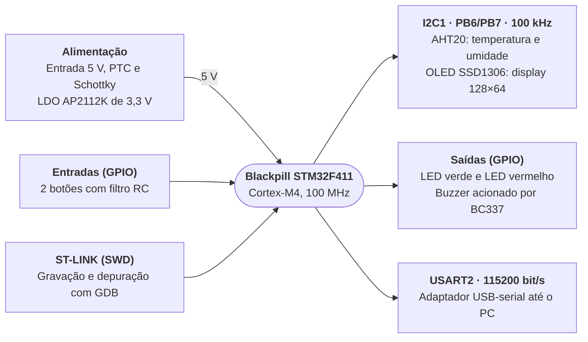
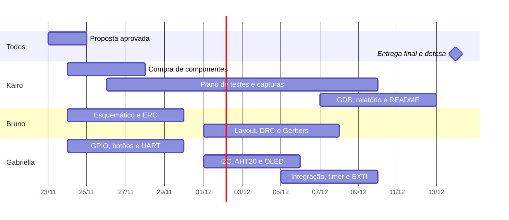

# Monitor Ambiental de Temperatura e Umidade com Alarme

Projeto final de **Sistemas Embarcados I** — FEELT/UFU

Placa-base para a **Blackpill STM32F411** que mede temperatura e umidade com um sensor **AHT20** e mostra os valores em um display **OLED**, ambos via I2C. Dois botões ajustam o limite de alarme; LEDs e um buzzer indicam o estado. Quando a temperatura passa do limite, o sistema aciona o alarme e envia os dados ao PC pela UART.

Todo o firmware é **bare-metal**, com acesso direto aos registradores.

---

## 1. Integrantes e divisão de tarefas

Cada integrante é responsável principal por uma frente e revisor das outras duas. Todos terão commits no repositório do projeto.

| Integrante | Frente principal | Responsabilidades | Revisa |
|---|---|---|---|
| Bruno Borges Medeiros | Hardware | Esquemático e layout da PCB no Altium, DRC/ERC, Gerbers, BOM e visualização 3D | Firmware (mapa de pinos) |
| Gabriella Costa Oliveira | Firmware | Drivers (GPIO, I2C, UART, timer, EXTI), driver do sensor e do display, aplicação | Esquemático |
| Kairo de Melo Sousa | Validação e documentação | Plano de testes, capturas com analisador lógico, sessão de depuração com GDB, relatório e README | Layout da PCB e firmware |

Como o grupo tem 3 integrantes, o escopo inclui os requisitos obrigatórios e dois itens opcionais:

- **Item 1:** interrupção externa (EXTI) e timer na leitura.
- **Item 2:** um segundo barramento, UART com o PC.

---

## 2. Diagrama de blocos



A placa-base recebe 5 V, protege a entrada e gera 3,3 V para o sensor e o display. A Blackpill fica no centro: lê os botões, conversa com o AHT20 e o OLED pelo I2C, aciona LEDs e buzzer e envia os dados ao PC pela UART.

---

## 3. Lista preliminar de componentes

A lista cobre a placa-base e os módulos externos; valores finais serão fechados no esquemático.

| Qtd | Componente | Função | Datasheet |
|---|---|---|---|
| 1 | WeAct Blackpill STM32F411CEU6 | Microcontrolador (encaixado na placa-base) | WeAct · STM32F411CE |
| 1 | Módulo AHT20 | Sensor de temperatura e umidade (I2C) | AHT20 |
| 1 | Display OLED 0,96" 128×64 (SSD1306, I2C) | Interface com o usuário | SSD1306 |
| 1 | Regulador LDO AP2112K-3.3 | 3,3 V para sensor e display | AP2112 |
| 1 | Diodo Schottky 1N5817 | Proteção contra inversão de polaridade | 1N5817 |
| 1 | Fusível rearmável PTC 500 mA | Proteção contra sobrecorrente | genérico |
| 1 | Buzzer ativo 5 V | Alarme sonoro | genérico |
| 1 | Transistor NPN BC337 + resistor de base 1 kΩ | Acionamento do buzzer | BC337 |
| 1 | Diodo 1N4148 | Roda-livre do buzzer | 1N4148 |
| 2 | LED 5 mm (verde e vermelho) + resistor 330 Ω | Indicação de estado e alarme | genérico |
| 2 | Botão táctil 6×6 mm + filtro RC (10 kΩ, 100 nF) | Ajuste do limite e troca de tela | genérico |
| 2 | Resistor 4,7 kΩ | Pull-up do I2C (SCL e SDA) | genérico |
| — | Capacitores 100 nF e 10 µF | Desacoplamento e entrada/saída do LDO | genérico |
| — | Barras de pinos fêmea, borne de 2 vias, conectores de 4 e 3 pinos | Blackpill, alimentação, módulos I2C e UART | genérico |
| 1 | Adaptador USB-serial (CH340 ou CP2102) | Ligação UART com o PC | genérico |

Os datasheets foram conferidos pelo grupo em 23/11/2026, incluindo o do BC337 (documento BC337-FSC/D da onsemi).

---

## 4. Microcontrolador escolhido e justificativa

O grupo usará o **STM32F411CEU6** na placa WeAct Blackpill, encaixada por barras de pinos na placa-base projetada pelo grupo.

- **Periféricos:** tem I2C, USART, timers de uso geral, SysTick, EXTI e ADC, que cobrem os requisitos e os opcionais com folga.
- **Desempenho e memória:** Cortex-M4 até 100 MHz, 512 KB de Flash e 128 KB de SRAM, muito acima do necessário para o firmware e o framebuffer de 1 KB do display.
- **Disponibilidade e custo:** o grupo já possui as placas e o gravador ST-LINK usados na disciplina, então o custo do MCU é zero.
- **Continuidade:** é o microcontrolador estudado nas aulas, com startup, linker script e drivers de GPIO e SysTick já desenvolvidos nos laboratórios.
- **Encapsulamento:** usar a Blackpill evita soldar um QFN de 48 pinos e mantém o foco do layout nos periféricos, na alimentação e no barramento.

---

## 5. Barramento e dispositivos externos

O barramento obrigatório é o **I2C**, com dois dispositivos externos reais. A **UART** com o PC é o segundo barramento (item opcional).

| Barramento | Periférico e pinos | Dispositivo | Endereço / formato | Taxa |
|---|---|---|---|---|
| I2C (obrigatório) | I2C1: PB6 (SCL), PB7 (SDA) | Sensor de temperatura e umidade AHT20 | 0x38 (7 bits) | 100 kHz (Standard mode) |
| I2C (obrigatório) | I2C1: PB6 (SCL), PB7 (SDA) | Display OLED 128×64 com controlador SSD1306 | 0x3C (7 bits) | 100 kHz |
| UART (opcional) | USART2: PA2 (TX), PA3 (RX) | PC, via adaptador USB-serial | 8N1, sem controle de fluxo | 115200 bit/s |

### Protocolo do AHT20

O firmware envia o comando de medição `0xAC 0x33 0x00`, espera cerca de 80 ms e lê 7 bytes: estado, 20 bits de umidade, 20 bits de temperatura e CRC. A conversão é:

```
UR = S / 2^20 × 100 %
T  = S / 2^20 × 200 − 50 °C
```

### Dimensionamento dos pull-ups do I2C

O barramento usa resistores de **4,7 kΩ** para 3,3 V, dentro da faixa calculada abaixo (corrente máxima de 3 mA em nível baixo, tempo de subida de 1000 ns e capacitância estimada do barramento de 100 pF). Os pull-ups dos módulos comprados serão verificados, e os da placa ficarão em jumpers de solda para não ficarem em paralelo.

```
R mínimo = (VDD − VOL) / IOL = (3,3 V − 0,4 V) / 3 mA ≈ 0,97 kΩ
R máximo = tr / (0,8473 × Cb) = 1000 ns / (0,8473 × 100 pF) ≈ 11,8 kΩ
```

A validação será feita com analisador lógico, capturando a transação com o AHT20 (endereço, ACK, comando e dados) e medindo a frequência do SCL.

---

## 6. Critérios de sucesso

O projeto será considerado bem-sucedido se passar nos testes abaixo, demonstrados na defesa.

| O que será demonstrado | Como será testado | Resultado esperado |
|---|---|---|
| Leitura do sensor | Comparar com termômetro e higrômetro de referência, lado a lado, por 10 min | Diferença de até 1 °C e até 5 % UR |
| Alarme por limite | Aquecer o sensor com a mão ou um secador até passar do limite | LED vermelho e buzzer em até 2 s; volta ao verde abaixo do limite menos 0,5 °C (histerese) |
| Botões com debounce | Pressionar cada botão 20 vezes | Limite muda exatamente 1 °C por pressionamento, sem contagens duplas |
| Barramento I2C | Captura com analisador lógico | SCL em 100 kHz (±10 %), ACK nos endereços 0x38 e 0x3C e bytes decodificados iguais aos esperados |
| Atualização periódica (timer) | Analisador lógico no I2C e no TX da UART | Uma leitura do sensor por segundo (±5 %) |
| UART com o PC | Terminal serial no PC por 5 min | Uma linha por segundo com temperatura, umidade e estado, sem caracteres corrompidos |
| Botão por interrupção (EXTI) | Breakpoint no GDB dentro da rotina de interrupção | A rotina é chamada a cada pressionamento |
| Depuração | Sessão ao vivo com GDB e OpenOCD via SWD | Breakpoint, leitura dos registradores do I2C1 e do GPIO e leitura das variáveis de temperatura |
| Projeto da placa | ERC e DRC no Altium | Sem erros, ou avisos justificados no relatório |

---

## 7. Cronograma

Etapas de 23/11 a 14/12 (2026). Hardware e firmware andam em paralelo até a entrega.



O esquemático e os drivers básicos ficam prontos na primeira semana, para que o layout e o driver I2C avancem juntos na segunda. A terceira semana fica para integração, testes, sessão de depuração e relatório, com um dia de folga antes da entrega.

---

## 8. Custo estimado

O custo estimado é de cerca de **R$ 115**, ou cerca de R$ 40 por integrante. Os valores são aproximados e serão atualizados com os preços reais da compra.

| Item | Custo aproximado |
|---|---|
| Blackpill STM32F411 e gravador ST-LINK | R$ 0 (o grupo já possui) |
| Módulo AHT20 | R$ 20 |
| Display OLED 0,96" SSD1306 | R$ 25 |
| Componentes da placa (LDO, diodos, PTC, transistor, buzzer, LEDs, botões, resistores, capacitores, conectores) | R$ 30 |
| Adaptador USB-serial | R$ 20 |
| Protoboard e jumpers para o protótipo | R$ 20 |
| **Total** | **R$ 115** |

A fabricação da placa não está incluída: o prazo de entrega de fabricantes externos dificilmente cabe até 14/12. O firmware será validado com a Blackpill e os módulos em protoboard, seguindo o mesmo esquemático da placa. O analisador lógico e o osciloscópio usados na validação são os do laboratório, sem custo para o grupo.
